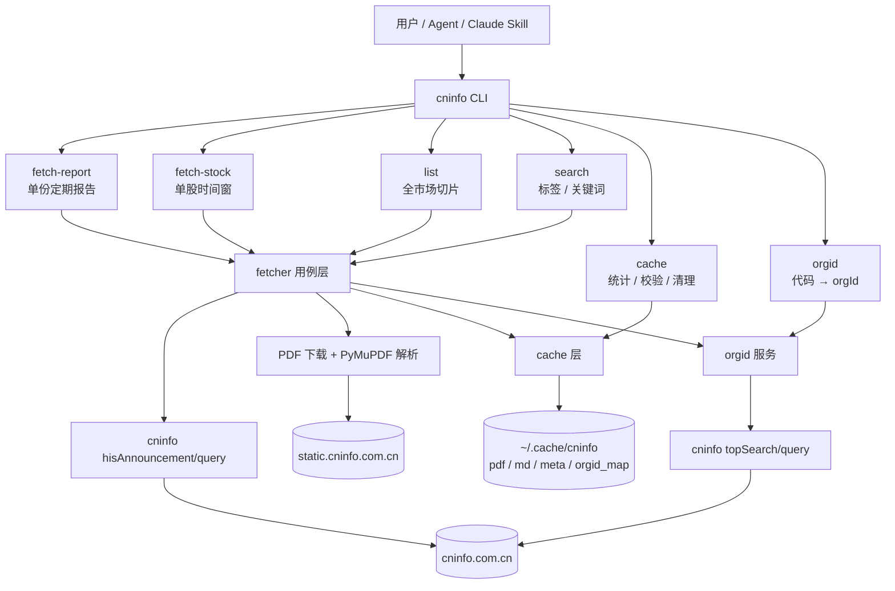

# cninfo-cli Code Wiki

> 版本：0.1.0 · 面向 Python 3.10+ · 文档基于仓库当前代码与 `docs/` 实测笔记整理

`cninfo-cli` 是一个**按需召唤型**的 A 股公告抓取工具：从巨潮资讯网（cninfo.com.cn）查询上市公司公告，下载 PDF，用 PyMuPDF 提取全文 Markdown，并写入本地长期缓存。再次访问同一公告时命中缓存，秒级返回。

它同时提供三种使用形态：

| 形态 | 入口 | 说明 |
|---|---|---|
| 命令行 | `cninfo` 命令 | 6 个子命令，JSON 或表格输出 |
| Python 包 | `import cninfo` | 可复用 `api` / `cache` / `fetcher` 等模块 |
| Claude Code skill | `skill/SKILL.md` | 让 agent 在对话中直接调用 CLI |

项目**不是**后台调度系统、增量同步器或数据池；所有命令都是一次性执行，跑完即停。

---

## 整体一览



### 命令能力对照

| 子命令 | 查询范围 | 下载 PDF | 需要 orgId | 默认落缓存 |
|---|---|---|---|---|
| `fetch-report` | 单股单份定期报告 | 是 | 是 | 是 |
| `fetch-stock` | 单股时间窗 | 仅 `--download` | 是 | 仅 `--download` |
| `list` | 全市场板块切片 | 仅 `--download` | 否 | 仅 `--download` |
| `search` | 单股或全市场 | 仅 `--download` | 股票模式需要 | 仅 `--download` |
| `cache` | 本地缓存 | 否 | 否 | 管理缓存 |
| `orgid` | 映射查询 | 否 | 缺失时回源 | 写 `orgid_map.json` |

---

## 快速开始

### 安装

```bash
git clone https://github.com/rollysys/use_cninfo.git
cd use_cninfo

# 推荐：uv tool install，装到独立 venv 并暴露全局 cninfo 命令
uv tool install -e .

# 或 pip 直装
pip install -e .
```

可选安装公告分类器（仅 `search --type/--sub-type` 需要）：

```bash
git clone https://github.com/rollysys/announcement_filter.git
cd announcement_filter && pip install -e .
```

### 运行

```bash
# 拿贵州茅台 2024 年报（下载 PDF + 提取 md）
cninfo fetch-report 600519 --year 2024 --kind annual

# 查看某股票 2024 年 4 月的全部公告（仅列表）
cninfo fetch-stock 600519 --since 2024-04-01 --until 2024-04-30

# 全市场切片：2024-04-29 深市所有年报
cninfo list --plate sz --category annual --date 2024-04-29 --limit 20

# 标签搜索（需 announcement_filter）
cninfo search --stock 600519 --since 2024-01-01 --until 2024-12-31 \
              --type shareholder --sub-type reduce_plan

# 缓存管理
cninfo cache stats
cninfo orgid 600519
```

模块方式运行（等效于 `cninfo` 命令，需已可导入本包）：

```bash
python -m cninfo.cli --help
```

### 二次运行

同一公告的 `pdf + md + meta` 三件套齐全时直接命中缓存，不再发网络请求。强制重下加 `--force`。

---

## 文档导航

| 文档 | 内容 |
|---|---|
| [architecture.md](architecture.md) | 整体架构、分层依赖、核心数据流、缓存生命周期、环境变量、错误传播 |
| [modules.md](modules.md) | 各模块职责、关键符号、模块依赖矩阵、边界原则 |
| [core-api.md](core-api.md) | `api.py` 常量与函数详解、`parser.py` PDF 解析详解 |
| [cache-and-orgid.md](cache-and-orgid.md) | 缓存布局与读写、命中策略、frontmatter、stats/verify/prune；orgId 解析与持久化 |
| [fetcher.md](fetcher.md) | `FetchResult` 数据结构、单条抓取流程、迭代器、定期报告定位 |
| [cli.md](cli.md) | 6 个子命令的参数、行为、输出格式、退出码与错误处理 |
| [development.md](development.md) | 安装/运行、测试策略、离线 fixture、CI、Lint、排障、已知限制 |

推荐阅读顺序：`README` → `architecture` → `modules` → 各模块详解 → `development`。

---

## 项目结构

```text
.
├── src/cninfo/              # Python 包（运行时）
│   ├── __init__.py          # 版本号 + api 层公共符号导出
│   ├── api.py               # cninfo HTTP 客户端、时区/标题清洗、PDF 直链
│   ├── parser.py            # PyMuPDF 全文提取
│   ├── cache.py             # ~/.cache/cninfo/ 三件套 + orgid_map 读写
│   ├── orgid.py             # secCode → orgId（topSearch）
│   ├── classify.py          # announcement_filter 薄包装（可选依赖）
│   ├── fetcher.py           # 协调 api + parser + cache + orgid
│   └── cli.py               # argparse，6 个子命令
├── tests/                   # 32 个离线 pytest 测试 + fixtures
├── docs/                    # 接口实测知识（只读参考）
│   ├── api_reference.md
│   ├── capabilities.md
│   ├── gotchas.md
│   └── cookbook.py
├── skill/SKILL.md           # Claude Code skill 入口
├── .github/workflows/ci.yml # ruff + pytest（3.10/3.11/3.12）
├── pyproject.toml           # hatchling 构建、依赖、console script
├── README.md
├── CLAUDE.md
└── LICENSE
```

---

## 核心概念与术语

| 术语 | 含义 |
|---|---|
| 公告（announcement） | cninfo 上的一条法定披露记录，由 `announcementId` 唯一标识 |
| 定期报告 | 年报 / 一季报 / 半年报 / 三季报，分别记为 `annual` / `q1` / `h1` / `q3` |
| 报告本体 | 真正的报告全文，排除“摘要”“审计报告”“内部控制”“提示性公告”等附属文件 |
| `ann_id` | cninfo 的 `announcementId`，本地缓存的主键 |
| `sec_code` | 6 位股票代码，如 `600519`（cninfo 返回值不带后缀） |
| `ts_code` | 带交易所后缀的代码，如 `600519.SH`、`301580.SZ`、`870132.BJ` |
| `orgId` | cninfo 内部公司 ID；按股票查询 `stock` 参数必须携带 |
| `plate` | 板块：`sz`（深市/创业板）、`sh`（沪市/科创板）、`bj`（北交所） |
| `category` | cninfo 原生类目，如 `category_ndbg_szsh`（年报） |
| `searchkey` | cninfo 原生标题模糊搜索参数（LIKE），不可用于精确匹配 |
| `adjunctUrl` | PDF 相对路径，拼接 `http://static.cninfo.com.cn/` 得到直链 |
| 缓存三件套 | 同一公告的 `pdf` + `md` + `meta` 三个文件，齐全才算命中 |
| 扫描件 | 图片型 PDF，PyMuPDF 提取不到文本，`extracted_pages=0` |

---

## 关键设计原则

1. **按需执行**：不维护后台任务、不做增量调度、不建数据库。
2. **单向依赖**：`api`/`parser` → `cache` → `orgid`/`classify` → `fetcher` → `cli`，下层不反向依赖上层。
3. **缓存以文件为中心**：PDF、Markdown、元数据各一份，目录结构可被外部工具直接消费。
4. **离线可测**：默认拦截真实网络，所有测试基于 fixture 与 mock。
5. **接口约束照单全收**：`pageSize=30`、`stock=<code>,<orgId>`、UTC epoch ms 等限制在客户端适配，不试图“修复”上游。
