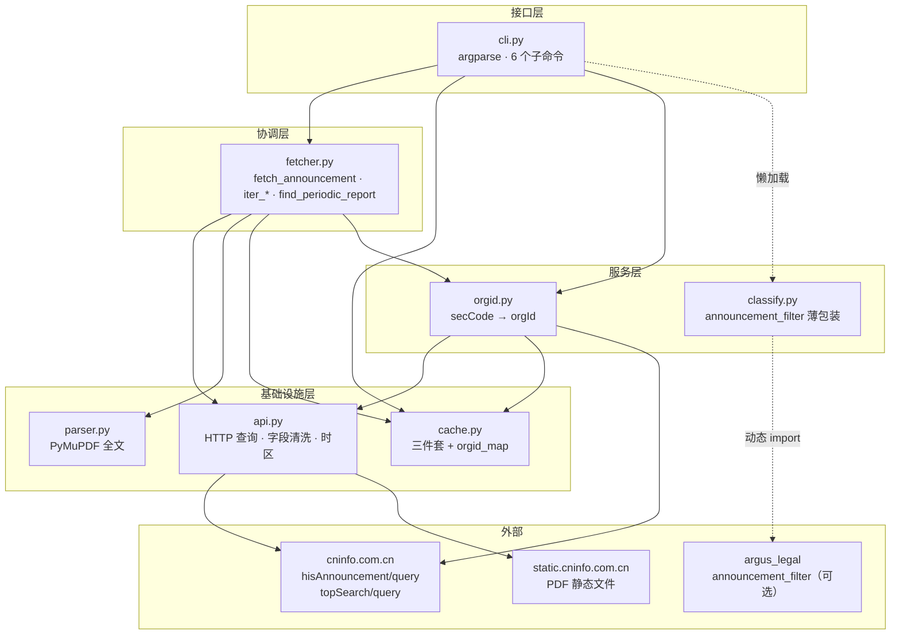
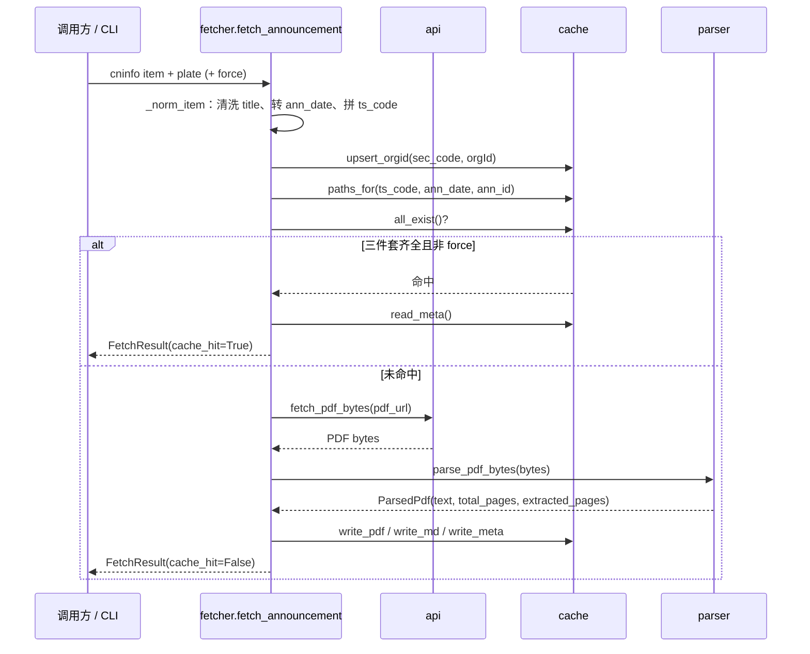
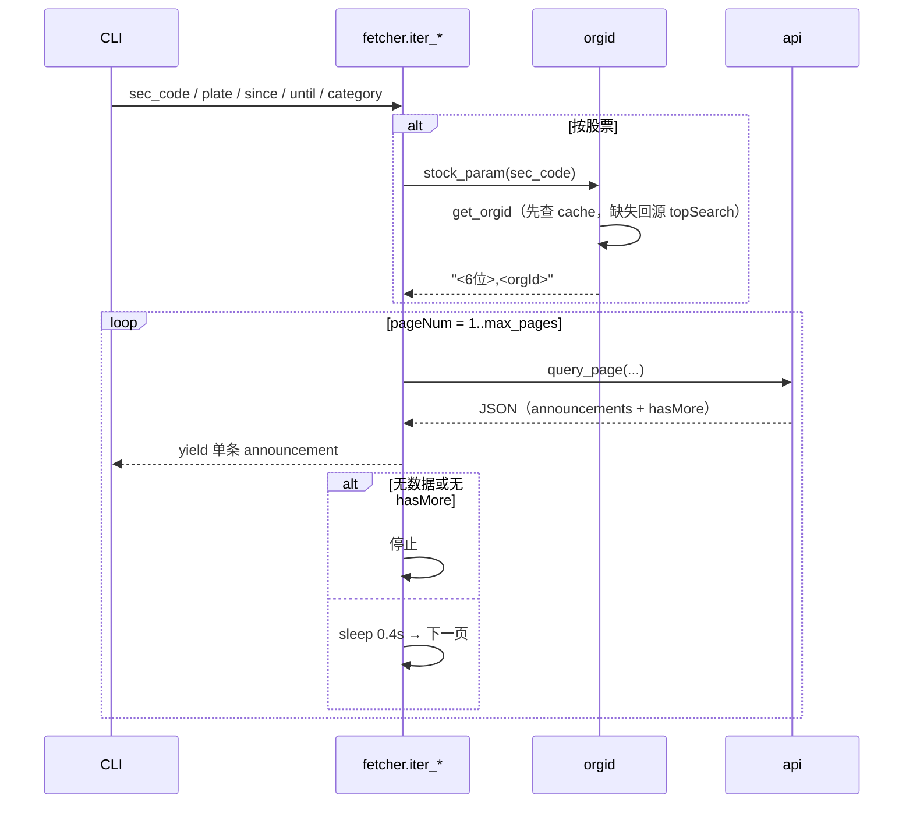
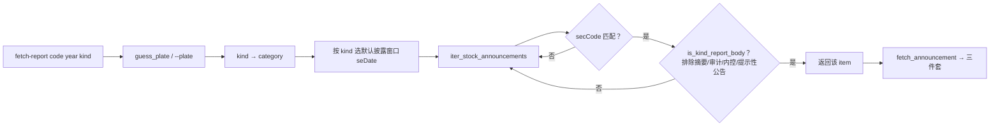
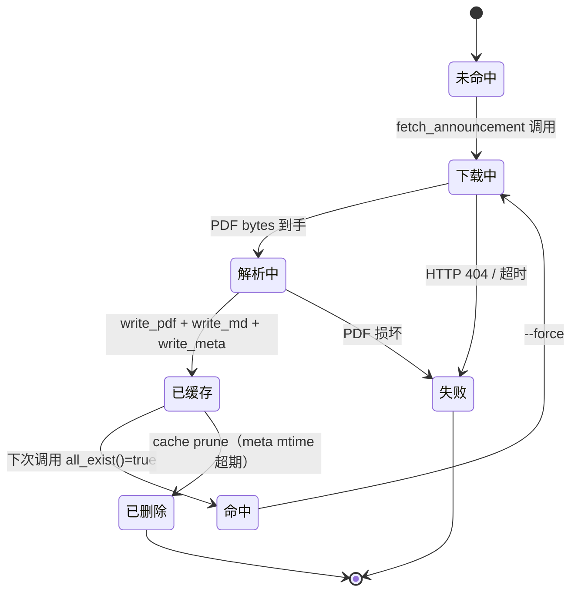
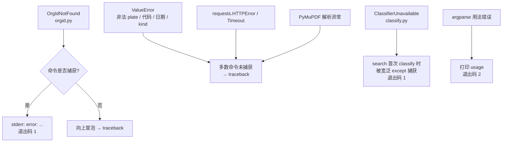

# 整体架构

## 1. 定位与设计目标

`cninfo-cli` 解决的是“**临时、少量、按需**地把 cninfo 公告变成本地可读文件”的问题：

- 输入：股票代码 / 板块 / 日期 / 类目 / 关键词
- 输出：公告列表，或每条公告的 PDF 路径 + Markdown 路径 + 解析统计
- 副作用：写入 `~/.cache/cninfo/`，供后续命令与外部工具复用

非目标（刻意不做）：后台常驻、定时增量同步、全量回补调度、本地全文检索、OCR、数据库。

## 2. 分层架构



### 分层职责

| 层 | 模块 | 职责 | 是否发网络 |
|---|---|---|---|
| L1 基础设施 | `api.py` | 构造请求参数、翻页、字段/时区清洗、PDF 直链下载 | 是 |
| L1 基础设施 | `parser.py` | 从 PDF 二进制或文件提取全文 | 否 |
| L1 基础设施 | `cache.py` | 三件套与 orgId 映射的持久化、统计、校验、清理 | 否 |
| L2 服务 | `orgid.py` | 维护 `secCode → orgId`，缺失时回源 topSearch | 是（仅缺失时） |
| L2 服务 | `classify.py` | 调用外部 `argus_legal.AnnouncementClassifier` 打标签 | 否 |
| L3 协调 | `fetcher.py` | 把查询、缓存、下载、解析编排成用例 | 是 |
| L4 接口 | `cli.py` | 参数解析、调用用例、格式化输出、错误码 | 间接 |

## 3. 依赖方向

依赖严格自下而上，**不存在反向 import**：

```text
api.py        ← 仅依赖 requests / 标准库
parser.py     ← 仅依赖 PyMuPDF
cache.py      ← 仅依赖标准库
orgid.py      ← api.DEFAULT_HEADERS + cache
classify.py   ← 仅动态 import 外部 argus_legal
fetcher.py    ← api + parser + cache + orgid
cli.py        ← api + cache + fetcher + orgid（classify 懒加载）
```

`src/cninfo/__init__.py` 额外把 `api.py` 的公共符号（4 个 category 常量、`query_page`、`query_all`、`clean_title` 等）提升到包顶层，方便 `from cninfo import query_all`。

### 依赖矩阵

| 被依赖 ↓ / 依赖方 → | `api` | `parser` | `cache` | `orgid` | `classify` | `fetcher` | `cli` |
|---|---|---|---|---|---|---|---|
| `api` | — | | | ✓ | | ✓ | ✓ |
| `parser` | | — | | | | ✓ | |
| `cache` | | | — | ✓ | | ✓ | ✓ |
| `orgid` | ✓ | | ✓ | — | | ✓ | ✓ |
| `classify` | | | | | — | | ✓（懒） |
| `fetcher` | ✓ | ✓ | ✓ | ✓ | | — | ✓ |

## 4. 核心数据流

### 4.1 单条公告抓取（缓存未命中）



### 4.2 公告列表查询



### 4.3 定期报告定位



## 5. 缓存生命周期



要点：

- **命中条件是三件套同时存在**，任一缺失都会重新走“下载 + 解析 + 重写三件套”。
- 命中时**不发任何网络请求**。
- `meta/<ann_id>.json` 是缓存命中路径重建 `FetchResult` 的统计来源（页数、字符数、category）。
- `cache prune` 以 `meta` 文件的 mtime 为基准，删除对应的 pdf/md/meta。
- 同一公告若出现重复记录（不同 `ann_id`、内容相同），缓存层不会自动去重；去重策略属于调用方。

## 6. 配置与环境变量

| 变量 | 默认值 | 作用 | 使用方 |
|---|---|---|---|
| `CNINFO_CACHE_DIR` | `~/.cache/cninfo` | 覆盖缓存根目录 | `cache.cache_root()` |
| `CNINFO_ALLOW_NETWORK` | 未设置 | 设为 `1` 时测试允许真实网络；否则 `conftest.py` 拦截 `requests.get/post` | 仅测试 |

网络端点（硬编码常量）：

| 常量 | 值 | 用途 |
|---|---|---|
| `CNINFO_QUERY` | `http://www.cninfo.com.cn/new/hisAnnouncement/query` | 公告列表查询 |
| `TOPSEARCH_URL` | `http://www.cninfo.com.cn/new/information/topSearch/query` | secCode → orgId |
| `PDF_BASE` | `http://static.cninfo.com.cn/` | PDF 直链前缀 |

## 7. 错误类型与传播

| 异常 | 定义位置 | 触发条件 | CLI 是否处理 |
|---|---|---|---|
| `OrgIdNotFound` | `orgid.py`（继承 `LookupError`） | topSearch 无精确匹配、或 `--cache-only` 时缓存缺失 | `fetch-report` / `fetch-stock` / `search` / `orgid` 捕获并返回码 1 |
| `ClassifierUnavailable` | `classify.py`（继承 `RuntimeError`） | 未安装 `argus_legal` | `search` 在首次 `classify()` 时被宽泛 `except Exception` 捕获 |
| `ValueError` | 多处抛出 | 非法 `plate`、非法 6 位代码、`iter_market_slice` 缺日期、未知 `kind` | 多数未捕获，会以 traceback 退出 |
| `requests.HTTPError` | 第三方 | cninfo 返回 4xx/5xx、PDF 404 | 未捕获 |
| PyMuPDF 异常 | 第三方 | PDF 损坏/非 PDF | 未捕获 |
| argparse 错误 | 标准库 | 缺少必填参数、非法 choices | argparse 自身打印用法并以码 2 退出 |

> 注意：argparse 的用法错误退出码也是 **2**，与 `fetch-report` 的“未找到报告”退出码相同；脚本化调用时建议结合 stderr 文案区分。

### 7.1 异常传播路径



### 7.2 子命令调用链

| 子命令 | CLI 动作函数 | 用例层调用 | 最终涉及的底层模块 |
|---|---|---|---|
| `fetch-report` | `cmd_fetch_report` | `find_periodic_report` → `fetch_announcement` | `api` / `orgid` / `parser` / `cache` |
| `fetch-stock` | `cmd_fetch_stock` | `iter_stock_announcements` →（可选）`fetch_announcement` | `api` / `orgid` / `parser` / `cache` |
| `list` | `cmd_list` | `iter_market_slice` →（可选）`fetch_announcement` | `api` / `parser` / `cache` |
| `search` | `cmd_search` | `iter_stock_announcements` / `iter_market_slice` → `classify` →（可选）`fetch_announcement` | `api` / `orgid` / `classify` / `parser` / `cache` |
| `cache` | `cmd_cache` | `stats` / `verify` / `prune_older_than` | `cache` |
| `orgid` | `cmd_orgid` | `get_orgid` / `lookup_orgid` | `orgid` / `api` / `cache` |

## 8. 扩展点

| 需求 | 改动位置 | 同步事项 |
|---|---|---|
| 新增 category / 周期类型 | `api.py` 常量与 `KIND_TO_CATEGORY` / `KIND_TO_TITLE_TAIL` | 更新 `docs/api_reference.md` |
| 新增 CLI 子命令 | `cli.py:build_parser()` + `cmd_xxx` | 在 `tests/test_cli.py` 用 `main([...])` 加覆盖 |
| 修改缓存布局 | `cache.paths_for()` | 同步 `verify()` / `prune_older_than()`、README、SKILL.md |
| 更换 orgId 来源 | `orgid.lookup_orgid()` | 保持签名，更新 `gotchas.md #2` |
| 新增公告分类规则 | 外部 `announcement_filter` 仓库 | 本仓库只做薄包装，不改 `classify.py` 接口 |

## 9. 架构约束（团队约定）

- 不要把工具改造成有后台 / 增量 / 数据池的系统。
- 不把 `argus_legal` 写进 `pyproject.toml`（未发布到 PyPI，保持可选）。
- 不在测试里发真实网络请求。
- `docs/cookbook.py` 是接口知识参考，不是生产代码。
- 不为下游 skill 做特殊适配，下游直接读缓存目录。
