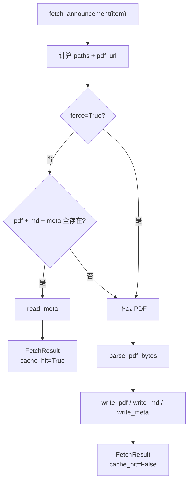
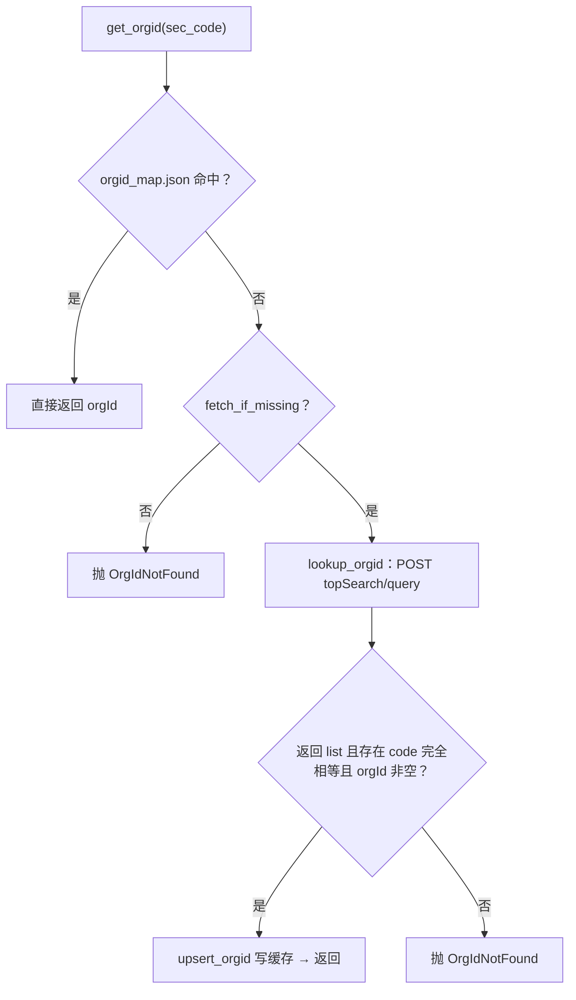
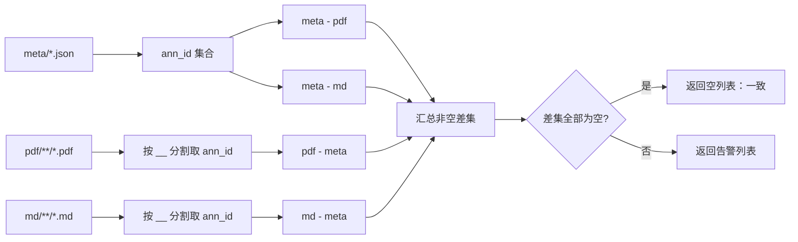

# 缓存与 orgId：`cache.py` / `orgid.py`

---

## 1. 缓存布局

默认根目录 `~/.cache/cninfo/`，可用环境变量 `CNINFO_CACHE_DIR` 覆盖（支持 `~` 展开）。

```text
<root>/
├── orgid_map.json                          # {"600519": "gssh0600519", ...}
├── pdf/<ts_code>/<ann_date>__<ann_id>.pdf  # 原始 PDF
├── md/<ts_code>/<ann_date>__<ann_id>.md    # YAML frontmatter + 全文
└── meta/<ann_id>.json                      # cninfo 原始 item + 派生字段
```

示例：

```text
~/.cache/cninfo/pdf/600519.SH/20240412__9999000001.pdf
~/.cache/cninfo/md/600519.SH/20240412__9999000001.md
~/.cache/cninfo/meta/9999000001.json
```

设计取舍：

- PDF 与 md 按 `ts_code` 分目录，便于 `ls` / `grep -r` 按股票检索。
- meta 只按 `ann_id` 平铺，因为 `ann_id` 全局唯一，也便于 `verify` / `prune` 扫描。
- 文件名使用 `ann_date__ann_id`，避免同名冲突且可按日期排序。

### 1.1 三类文件的角色

| 文件 | 内容 | 写入方 | 读取方 | 命中必需 |
|---|---|---|---|---|
| `pdf/<ts_code>/<date>__<id>.pdf` | 原始 PDF | `fetch_announcement` | 外部工具 / 用户 OCR | 是 |
| `md/<ts_code>/<date>__<id>.md` | frontmatter + 全文 | `fetch_announcement` | 用户 / 下游 skill | 是 |
| `meta/<ann_id>.json` | 原始 item + 派生统计 | `fetch_announcement` | 缓存命中路径 | 是 |
| `orgid_map.json` | `secCode → orgId` | `upsert_orgid` | `get_orgid` | 否（独立缓存） |

---

## 2. `CachePaths` 与路径规则

### 2.1 `cache_root() -> Path`

```python
DEFAULT_CACHE_ROOT = Path.home() / ".cache" / "cninfo"

def cache_root() -> Path:
    env = os.environ.get("CNINFO_CACHE_DIR")
    return Path(env).expanduser() if env else DEFAULT_CACHE_ROOT
```

每次调用都会重新读取环境变量，因此测试中 `monkeypatch.setenv` 立即生效。

### 2.2 `CachePaths`

| 字段 | 类型 | 说明 |
|---|---|---|
| `pdf` | `Path` | PDF 路径 |
| `md` | `Path` | Markdown 路径 |
| `meta` | `Path` | 元数据 JSON 路径 |

| 方法 | 语义 |
|---|---|
| `all_exist()` | 三者同时存在 → **缓存命中** |
| `any_exist()` | 任一存在 → 用于判断“是否有残留/不一致” |

### 2.3 `paths_for(ts_code, ann_date, ann_id) -> CachePaths`

```python
fname = f"{ann_date}__{ann_id}"
pdf  = root / "pdf"  / ts_code / f"{fname}.pdf"
md   = root / "md"   / ts_code / f"{fname}.md"
meta = root / "meta" / f"{ann_id}.json"
```

`ann_id` 会被 `str()` 化，兼容整数或字符串。

---

## 3. 读写接口

### 3.1 写入

| 函数 | 行为 |
|---|---|
| `write_pdf(paths, data)` | 创建父目录，写入二进制 |
| `write_md(paths, frontmatter, body)` | 手工拼 YAML frontmatter，再拼正文，UTF-8 写入 |
| `write_meta(paths, meta)` | `json.dumps(..., ensure_ascii=False, indent=2)` |

`write_md` 的 frontmatter 序列化规则：

- 字符串 → `key: "value"`
- 非字符串 → `key: <json.dumps(..., ensure_ascii=False)>`（数字、布尔等）

> 实现注意：字符串值用双引号直接包裹，未做 YAML 特殊字符转义。公告标题若含双引号，理论上可能影响 YAML 解析；当前正文章节以人类阅读为主，未做严格 YAML 兼容。

### 3.2 读取

| 函数 | 文件不存在时 |
|---|---|
| `read_meta(paths)` | 返回 `None` |
| `read_md(paths)` | 返回 `None` |

两者都不抛“文件不存在”异常。

### 3.3 Markdown frontmatter 字段

由 `fetcher.fetch_announcement` 写入：

| 字段 | 示例 | 说明 |
|---|---|---|
| `ann_id` | `"9999000001"` | 公告 ID |
| `ts_code` | `"600519.SH"` | 带后缀代码 |
| `sec_code` | `"600519"` | 6 位代码 |
| `sec_name` | `"贵州茅台"` | 公司简称 |
| `ann_date` | `"20240412"` | 北京日期 |
| `title` | `"贵州茅台2024年年度报告"` | 已清洗标题 |
| `category` | `"01010503"` | cninfo 的 `announcementType` |
| `source` | `"http://static...PDF"` | PDF 直链 |
| `total_pages` | `286` | 总页数 |
| `extracted_pages` | `286` | 有文本的页数 |
| `text_chars` | `412580` | 正文字符数 |

### 3.4 meta JSON 字段

meta 包含 frontmatter 的全部信息，另外补充：

| 字段 | 说明 |
|---|---|
| `org_id` | 公司 orgId |
| `adjunct_url` | cninfo 原始相对路径 |
| `adjunct_size_kb` | 附件大小（KB） |
| `pdf_url` | 拼接后的直链 |
| `raw` | cninfo 返回的原始 announcement 对象（完整保留） |

`raw` 使得后续可以在不重新请求的情况下追溯原始字段；也是 meta 文件体积的主要来源。

---

## 4. 命中策略

```text
if not force and paths.all_exist():
    命中 → read_meta → 用 meta 的 category / total_pages / extracted_pages / text_chars 组装 FetchResult
else:
    未命中 → 下载 PDF → 解析 → 重写 pdf + md + meta
```

| 场景 | 行为 |
|---|---|
| 三件齐全 | 命中，**不发网络**（连 meta 读取也只在本地） |
| 缺任一 | 未命中，重新下载并覆盖三件 |
| `--force` / `force=True` | 跳过命中检查，强制重下 |
| meta 存在但 pdf 缺失 | 未命中（`all_exist()` 为假） |
| pdf/md 存在但 meta 缺失 | 未命中 |

命中分支中，`title` / `ts_code` / `ann_date` 仍取自本次传入的 cninfo item，而非 meta；只有统计字段与 category 从 meta 读取。

**命中判断流程**



---

## 5. orgId 映射

### 5.1 为什么需要 orgId

cninfo 的 `hisAnnouncement/query` 在按股票查询时，`stock` 参数必须是 `<6位代码>,<orgId>`。只传 6 位会返回 0 条，而 cninfo 不公开映射表。`orgid.py` 通过 `topSearch/query` 解决。

### 5.2 解析流程



### 5.3 函数

#### `lookup_orgid(sec_code, *, timeout=10.0, session=None) -> str`

请求：

```http
POST http://www.cninfo.com.cn/new/information/topSearch/query
Content-Type: application/x-www-form-urlencoded

keyWord=600519&maxNum=10
```

响应为数组：

```json
[{"code":"600519","orgId":"gssh0600519","zwjc":"贵州茅台", "...":"..."}]
```

处理规则：

- 响应不是 `list` → `OrgIdNotFound`；
- 遍历并**精确匹配** `it["code"] == sec_code` 且 `orgId` 非空；
- 命中后 `upsert_orgid(sec_code, org_id)` 并返回；
- 无命中 → `OrgIdNotFound`。

#### `get_orgid(sec_code, *, fetch_if_missing=True) -> str`

缓存优先；缓存缺失且允许回源时调用 `lookup_orgid`；`fetch_if_missing=False` 时直接抛 `OrgIdNotFound`（对应 CLI `--cache-only`）。

#### `stock_param(sec_code) -> str`

```python
return f"{sec_code},{get_orgid(sec_code)}"
```

### 5.4 orgid_map 读写

| 函数 | 行为 |
|---|---|
| `orgid_map_path()` | `cache_root() / "orgid_map.json"` |
| `load_orgid_map()` | 不存在返回 `{}`；JSON 损坏也返回 `{}` |
| `save_orgid_map(m)` | 创建父目录，UTF-8 JSON，缩进 2，key 排序 |
| `upsert_orgid(sec_code, org_id)` | 值未变化则直接返回，否则读-改-写 |

### 5.5 额外的缓存来源

除了 `lookup_orgid`，`fetcher.fetch_announcement` 在归一化 cninfo 列表项时，若 item 自带 `orgId` 且 `secCode` 非空，会直接 `upsert_orgid`。因此：

- 一次全市场切片查询，就能顺带填充大量 `orgId`；
- 后续按股票查询通常无需再走 topSearch。

### 5.6 异常语义

```python
class OrgIdNotFound(LookupError):
    """sec_code 在 cninfo topSearch 中查不到 orgId（下市 / 代码错 / 接口变）。"""
```

CLI 捕获该异常并以退出码 1 返回，同时在 stderr 输出原因。

---

## 6. 统计、校验、清理

### 6.1 `CacheStats` 与 `stats()`

| 字段 | 说明 |
|---|---|
| `pdf_count` / `md_count` / `meta_count` | 各目录文件数（递归扫描） |
| `pdf_bytes` / `md_bytes` / `meta_bytes` | 各目录总字节数 |
| `orgid_count` | `orgid_map.json` 条目数 |
| `total_bytes`（property） | 三类字节数之和 |

`_scan_dir(p)` 对不存在目录返回 `(0, 0)`。

### 6.2 `verify() -> list[str]`

一致性检查基于 `ann_id` 集合：

- meta：`meta/*.json` 的文件名（stem）；
- pdf：`pdf/**/*.pdf` 的 stem 按 `__` 分割后取最后一段（即 ann_id）；
- md：同上。

产生四类告警：

```text
meta but no pdf: ann_id=<id>
meta but no md:  ann_id=<id>
pdf but no meta: ann_id=<id>
md but no meta:  ann_id=<id>
```

返回空列表表示一致。告警顺序取决于集合遍历，未排序。

**校验逻辑**



### 6.3 `prune_older_than(days) -> int`

1. 以 `time.time() - days*86400` 为截止；
2. 遍历 `meta/**/*.json`，`st_mtime` 早于截止的才处理；
3. 从 meta 读取 `ts_code` 与 `ann_date`，用 `paths_for` 还原三件路径；
4. 删除存在的 pdf / md / meta；
5. 统计删除条数（按 meta 文件计）；
6. 清理 `pdf/`、`md/` 下变空的 `ts_code` 目录。

```python
# CLI
cninfo cache prune --older-than 365d
```

**边界**：只处理“有 meta”的条目。仅有 pdf/md 而无 meta 的孤儿文件不会被删除，需先通过 `verify` 发现并手动处理。

> 时间基准是 **meta 文件的 mtime**，不是公告日期，也不是 PDF 访问时间。重写缓存会刷新 mtime。
