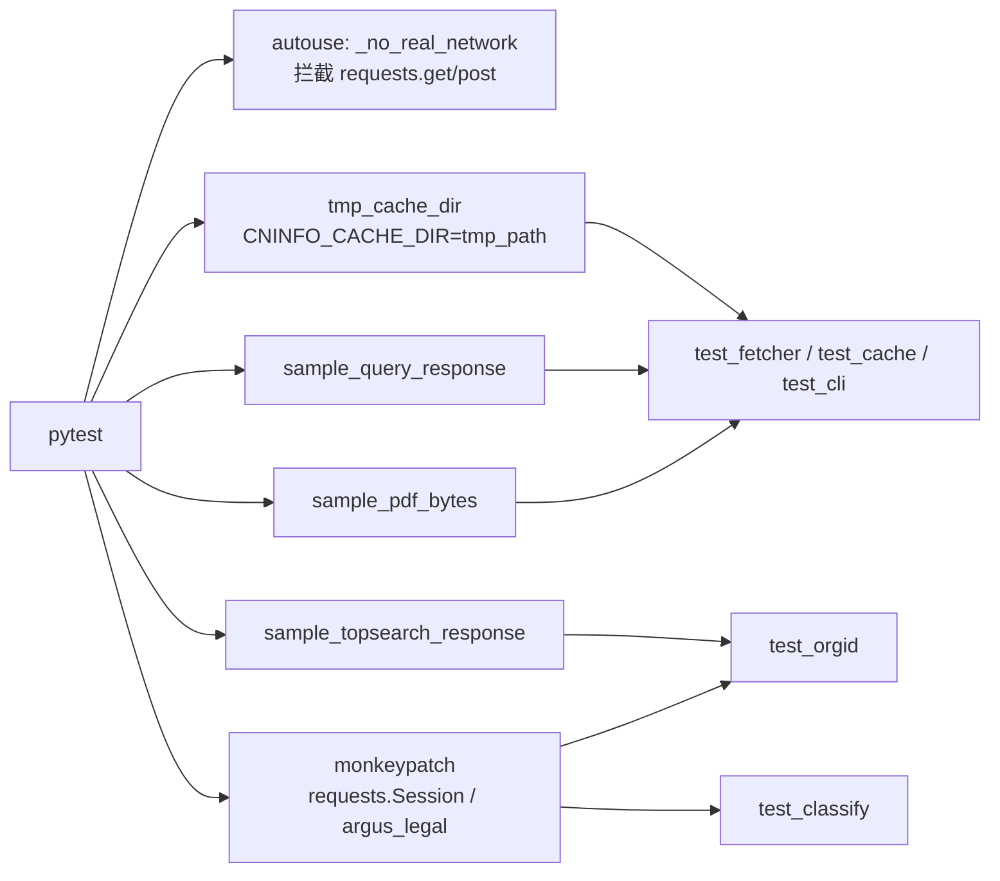
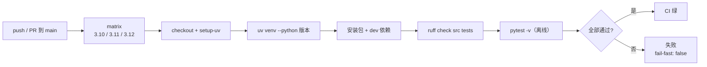

# 开发、测试与运行

本页覆盖本地开发环境、运行方式、测试体系、CI、编码约定、排障与已知限制。

---

## 1. 运行环境与依赖

### 1.1 运行时

| 项目 | 要求 |
|---|---|
| Python | `>=3.10`（CI 覆盖 3.10 / 3.11 / 3.12） |
| 构建后端 | `hatchling` |
| 打包目录 | `src/cninfo` |
| 控制台脚本 | `cninfo = cninfo.cli:main` |

### 1.2 依赖

| 依赖 | 版本 | 用途 |
|---|---|---|
| `requests` | `>=2.31` | cninfo 查询、PDF 下载 |
| `pymupdf` | `>=1.24` | PDF 全文提取 |
| `pytest` | `>=8.0` | 仅开发 |
| `ruff` | `>=0.5` | 仅开发 |
| `argus_legal` | 无版本约束、**不在 pyproject** | 可选；来自 `rollysys/announcement_filter` |

`argus_legal` 当前未发布到 PyPI，因此刻意不写入 `pyproject.toml`，只能源码安装。

---

## 2. 安装与运行

### 2.1 开发环境

```bash
uv venv --python 3.10
uv pip install -e ".[dev]"
```

### 2.2 三种运行方式

```bash
# 1) 安装 console script
uv tool install -e .        # 或 pip install -e .
cninfo --help

# 2) 不安装 console script 时，用模块方式（需包已可导入；也可 PYTHONPATH=src）
python -m cninfo.cli --help

# 3) Python API
python - <<'PY'
from cninfo.fetcher import fetch_announcement, find_periodic_report
item = find_periodic_report("600519", year=2024, kind="annual", plate="sh")
res = fetch_announcement(item, "sh")
print(res.md_path, res.cache_hit)
PY
```

### 2.3 可选分类器

```bash
git clone https://github.com/rollysys/announcement_filter.git
cd announcement_filter && pip install -e .
```

不装时其它 5 个命令正常工作，只有 `search --type/--sub-type` 会失败并提示安装。

### 2.4 联网 smoke test

单元测试默认离线。需要真实请求时显式放行：

```bash
CNINFO_ALLOW_NETWORK=1 cninfo fetch-report 600519 --year 2024 --kind annual
```

---

## 3. 测试体系

### 3.1 测试命令

```bash
uv run pytest                       # 全部（32 个）
uv run pytest tests/test_api.py     # 单文件
uv run pytest -k "cache_hit"        # 按名称过滤
uv run pytest -v
```

### 3.2 离线隔离机制

`tests/conftest.py` 提供 autouse fixture `_no_real_network`：

- 若 `CNINFO_ALLOW_NETWORK != "1"`，把 `requests.get` 与 `requests.post` 替换为抛 `RuntimeError` 的函数；
- 因此任何真实网络调用都会让测试立即失败；
- 需要网络的测试可设环境变量，或在测试内 `monkeypatch` 掉 `requests`。

`tmp_cache_dir` fixture 通过 `monkeypatch.setenv("CNINFO_CACHE_DIR", tmp_path)` 把缓存隔离到临时目录。

### 3.3 Fixtures

| Fixture / 文件 | 内容 |
|---|---|
| `fixtures_dir` | `tests/fixtures` 路径 |
| `sample_query_response` | 读取 `cninfo_query_sample.json`（含报告本体与摘要等样例） |
| `sample_topsearch_response` | 读取 `topsearch_600519.json` |
| `sample_pdf_bytes` | 读取 `sample.pdf`（2 页，可提取文本） |
| `tmp_cache_dir` | 临时缓存根目录 |

`tests/fixtures/_make_pdf.py` 用于重新生成样例 PDF（几乎不需要）。

**Fixture 关系**



### 3.4 测试覆盖地图

| 文件 | 数量 | 覆盖点 |
|---|---|---|
| `test_api.py` | 8 | 标题清洗、时区转换、PDF 直链、ts_code、板块推测、定期报告排除规则 |
| `test_cache.py` | 6 | 根目录环境变量、路径布局、三件套读写、orgid_map、stats/verify、prune |
| `test_classify.py` | 2 | 缺失依赖时的降级、正常调用外部分类器的桩实现 |
| `test_cli.py` | 5 | `--help`、`cache stats`、`orgid --cache-only`、`fetch-report` 全链路（mock） |
| `test_fetcher.py` | 5 | 写三件套、缓存命中跳过网络、`--force` 重下、报告本体选择、年份错误返回 `None` |
| `test_orgid.py` | 5 | 缓存命中、回源写缓存、请求参数、未命中异常、cache-only 异常 |
| `test_parser.py` | 1 | PDF 文本提取与页数统计 |

合计 **32** 个离线测试。

### 3.5 测试替身方式

- `unittest.mock.patch("cninfo.fetcher.fetch_pdf_bytes", ...)`：跳过真实 PDF 下载。
- `patch("cninfo.fetcher.iter_stock_announcements", fake_iter)`：跳过列表查询。
- `MagicMock` 模拟 `requests.Session.post(...)` 与响应。
- `monkeypatch.setitem(sys.modules, "argus_legal", fake_module)`：注入假分类器。

---

## 4. CI

配置文件：[.github/workflows/ci.yml](../.github/workflows/ci.yml)

触发：`push` / `pull_request` 到 `main`。

流程：

1. checkout；
2. 安装 uv；
3. 安装对应 Python 版本；
4. `uv venv --python <ver>`；
5. `uv pip install -e ".[dev]"`；
6. `uv run ruff check src tests`；
7. `uv run pytest -v`。

**CI 流程**



矩阵：Python 3.10、3.11、3.12，`fail-fast: false`（任一版本失败不取消其它版本）。

---

## 5. Lint 与代码风格

`pyproject.toml` 中 ruff 配置：

| 配置 | 值 |
|---|---|
| `line-length` | 110 |
| `target-version` | `py310` |
| 规则集 | `E`、`F`、`W`、`I`（import 排序）、`UP`（pyupgrade）、`B`（bugbear）、`SIM`（simplify） |
| 忽略 | `E501`（行过长） |

```bash
uv run ruff check src tests
uv run ruff check --fix src tests
```

代码约定：

- 文件开头 `from __future__ import annotations`。
- 公共函数写 docstring，说明上游约束与副作用。
- 模块间保持单向依赖，不在底层 import 上层。
- 网络与文件系统访问集中在 `api.py` / `orgid.py` / `cache.py`。

---

## 6. 改动指引

### 6.1 修改接口参数 / 新增 category

1. 改 [api.py](../src/cninfo/api.py) 的常量或函数；
2. 同步 [docs/api_reference.md](../docs/api_reference.md) 的参数/类目表；
3. 在 `tests/fixtures/` 补样例，在 `tests/test_api.py` 补单测。

### 6.2 新增 CLI 子命令

1. 在 `cli.py:build_parser()` 注册子 parser；
2. 实现 `cmd_xxx(args) -> int`；
3. 默认输出 JSON 或表格；
4. **必须**在 `tests/test_cli.py` 通过 `main([...])` 覆盖（至少检查退出码与 stderr）。

### 6.3 修改缓存布局

1. 改 `cache.paths_for()`；
2. 同步 `verify()` 与 `prune_older_than()` 的路径推导；
3. 同步 README 与 `skill/SKILL.md` 的缓存布局说明；
4. 更新 `tests/test_cache.py` 的路径断言。

### 6.4 更换 orgId 来源

只改 `orgid.lookup_orgid()`，保持函数签名；同步 `docs/gotchas.md #2`。

### 6.5 改动检查清单

| 改动类型 | 代码 | 文档 | 测试 |
|---|---|---|---|
| 新增 category / kind | `api.py` 常量与映射 | `docs/api_reference.md` | `test_api.py` |
| 新增 CLI 子命令 | `cli.py` parser + `cmd_xxx` | `wiki/cli.md`、README | `test_cli.py` 走 `main([...])` |
| 修改缓存布局 | `cache.paths_for` | README、SKILL.md、本 wiki | `test_cache.py` 路径断言 |
| 修改 frontmatter / meta | `fetcher.fetch_announcement` | 本 wiki 缓存页 | `test_fetcher.py` 内容断言 |
| 更换 orgId 来源 | `orgid.lookup_orgid` | `docs/gotchas.md #2` | `test_orgid.py` |
| 升级分类器规则 | 外部 `announcement_filter` | — | 手动 e2e |
| 修复 PDF 404 重试 | `fetcher.fetch_announcement` / `api` | `docs/gotchas.md #7` | 新增 mock 测试 |

---

## 7. 排障

| 症状 | 原因 | 处理 |
|---|---|---|
| `OrgIdNotFound: orgId not found for sec_code=XXX` | 代码错误 / 已退市 / topSearch 变更 | `cninfo orgid XXX --refresh`；确认代码与板块 |
| `no annual report body found ...` | 报告期窗口外、板块猜错、只有摘要 | 显式 `--plate`；检查披露时间；用 `fetch-stock` 看原始标题 |
| `announcement_filter not installed` | 未装 `argus_legal` | 按第 2.3 节源码安装 |
| 网络超时 / 503 | cninfo 短期限流 | 稍后重试；减少批量；必要时降速 |
| `cache verify` 报不一致 | 上次中断、手动删文件 | 按 ann_id 定位后 `--force` 重抓；孤儿文件手动清理 |
| `fetch-report` 报 traceback | 代码非法导致 `guess_plate` 抛 `ValueError` | 使用合法 6 位代码 |
| `list` 报 `ValueError: must specify either date or both since+until` | 未给时间范围 | 补 `--date` 或 `--since/--until` |
| `ExtractedPages=0` | PDF 是扫描件 | 保留 PDF 自行 OCR；本工具不内置 OCR |

---

## 8. 已知限制

来自 cninfo 接口本身：

1. **`pageSize` 服务端硬限 30**，全量必须翻页。
2. **`stock` 必须 `<6位>,<orgId>`**，只传 6 位返回 0 条。
3. **同一公告可能两条记录**（`announcementId` 不同、PDF 相同），工具不自动去重。
4. **2024-06 前部分 PDF URL 可能 404**，无内置重试/失败表。
5. **部分 PDF 是扫描件**，`extracted_pages=0`，不内置 OCR。

实现层面已知未做：

- `search` 对每条公告的 `type/sub_type` **不缓存**，全市场标签过滤会反复调用分类器。
- 老 PDF 404 的失败重试与 failure 表**未实现**。
- `search --type/--sub-type` 路径尚未在真实 `announcement_filter` 上做过 e2e 验证（仅验证缺失态降级）。
- 不提供并发下载、断点续传、任务队列。

---

## 9. 常用配方

### 9.1 只读缓存做全文检索

```bash
grep -r "营业收入" ~/.cache/cninfo/md/600519.SH/
```

### 9.2 全市场单日年报清单（不下载）

```bash
cninfo list --plate sz --category annual --date 2024-04-29 --json --limit 100
```

### 9.3 清理一年未访问的缓存

```bash
cninfo cache prune --older-than 365d
cninfo cache verify
```

### 9.4 给 Claude Code 安装 skill

```bash
mkdir -p ~/.claude/skills
ln -s "$(pwd)/skill" ~/.claude/skills/cninfo
```

之后可直接说“拿茅台 2024 年报”，agent 会调用 `cninfo` CLI。详见 [skill/SKILL.md](../skill/SKILL.md)。

---

## 10. 项目状态（截至仓库内笔记）

- 开源：`rollysys/use_cninfo`，public，MIT，`main` 为唯一发布分支。
- CI：lint + 离线测试，3.10/3.11/3.12 矩阵。
- 已在 `AI_Renaissance` 项目中通过 subprocess 调本 CLI 做上游集成（仓库内笔记记录）。
- 待补：分类器真实 e2e、老 PDF 失败重试、标签结果缓存。
