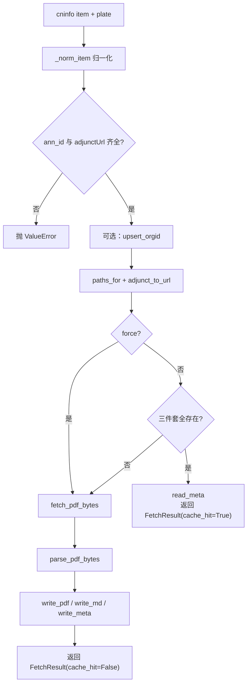
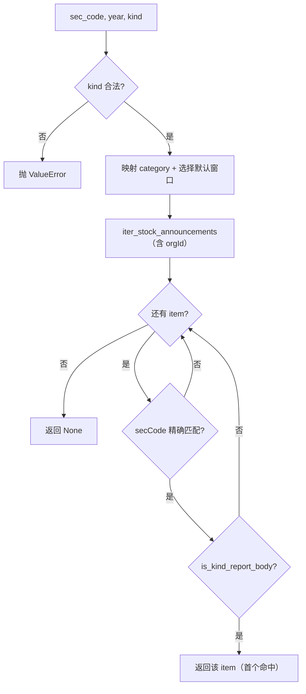

# 抓取协调层：`fetcher.py`

`fetcher.py` 是业务用例层，把 `api`（查询/下载）、`cache`（持久化）、`parser`（解析）、`orgid`（股票定位）编排起来。CLI 与 Python 调用方都通过它完成实际工作。

---

## 1. `FetchResult`

单条公告抓取结果，dataclass，可通过 `.to_dict()` 转成 JSON 友好的 dict（CLI `fetch-report` 直接输出）。

| 字段 | 类型 | 说明 |
|---|---|---|
| `ann_id` | `str` | 公告 ID（缓存主键） |
| `sec_code` | `str` | 6 位代码 |
| `ts_code` | `str` | 带后缀代码，如 `600519.SH` |
| `ann_date` | `str` | 北京日期 `YYYYMMDD` |
| `title` | `str` | 清洗后的标题 |
| `category` | `str \| None` | cninfo `announcementType`；命中缓存时优先取 meta |
| `pdf_url` | `str` | PDF 直链 |
| `pdf_path` | `str` | 本地 PDF 绝对/字符串路径 |
| `md_path` | `str` | 本地 Markdown 路径 |
| `meta_path` | `str` | 本地 meta JSON 路径 |
| `total_pages` | `int` | PDF 总页数 |
| `extracted_pages` | `int` | 有文本的页数 |
| `text_chars` | `int` | 正文字符数 |
| `cache_hit` | `bool` | 本次是否命中缓存 |

> 扫描件场景：`total_pages > 0` 但 `extracted_pages == 0`、`text_chars == 0`，PDF 仍然可用。

---

## 2. 归一化：`_norm_item(item, plate)`

把 cninfo 原始 announcement 对象转成内部统一结构。

| 输出字段 | 来源 | 处理 |
|---|---|---|
| `ann_id` | `announcementId` | `str()`，缺失为 `""` |
| `sec_code` | `secCode` | 原样 |
| `ts_code` | `secCode` + `plate` | `to_ts_code`；若 `plate` 不在 `sz/sh/bj` 则退回 `sec_code` |
| `sec_name` | `secName` | 原样 |
| `org_id` | `orgId` | 原样 |
| `ann_date` | `announcementTime` | epoch ms → 北京 `YYYYMMDD`；为 0/缺失时为 `""` |
| `title` | `announcementTitle` | `clean_title` 去除 `<em>` |
| `category` | `announcementType` | 原样（cninfo 数字型类目码） |
| `adjunct_url` | `adjunctUrl` | 原样相对路径 |
| `adjunct_size_kb` | `adjunctSize` | 原样 |
| `raw` | 整个 item | 完整保留，写入 meta |

---

## 3. `fetch_announcement(...)`

```python
fetch_announcement(
    item: dict,
    plate: str,
    *,
    force: bool = False,
    session: requests.Session | None = None,
) -> FetchResult
```

### 3.1 执行步骤

1. `_norm_item(item, plate)` 归一化。
2. 校验：`ann_id` 或 `adjunct_url` 为空 → `ValueError`。
3. 若 `org_id` 与 `sec_code` 都存在 → `upsert_orgid`，顺带积累映射。
4. `paths = paths_for(ts_code, ann_date, ann_id)`；`pdf_url = adjunct_to_url(adjunct_url)`。
5. **缓存判断**：`not force and paths.all_exist()`。
   - 命中：`read_meta`，用 meta 的 `category` / `total_pages` / `extracted_pages` / `text_chars` 组装结果，`cache_hit=True`。
   - 未命中：继续。
6. `fetch_pdf_bytes(pdf_url, session=session)` 下载。
7. `parse_pdf_bytes(pdf_bytes)` 解析。
8. 写三件套：
   - `write_pdf` 原始字节；
   - `write_md` frontmatter + 全文；
   - `write_meta` 原始 item + 派生字段。
9. 返回 `FetchResult(cache_hit=False)`。

**执行流程**



### 3.2 缓存命中与未命中的差异

| 维度 | 命中 | 未命中 |
|---|---|---|
| 网络 | 无 | 1 次 PDF GET |
| CPU | 仅读 meta | PDF 解析（数百页约 1–2s） |
| 写盘 | 无 | 写 3 个文件 |
| `title` | 来自本次 item | 来自本次 item |
| `category` | meta 优先 | 来自本次 item |
| 页数/字符数 | meta | 本次解析结果 |

### 3.3 异常

| 异常 | 触发 |
|---|---|
| `ValueError` | item 缺 `announcementId` 或 `adjunctUrl` |
| `requests.HTTPError` | PDF URL 404 / 5xx |
| `requests.Timeout` | 下载超时（默认 60s） |
| PyMuPDF 异常 | PDF 损坏或非 PDF |
| `OSError` | 缓存目录不可写 |

### 3.4 Python 调用示例

```python
from cninfo.api import adjunct_to_url
from cninfo.fetcher import fetch_announcement

item = {
    "secCode": "600519",
    "secName": "贵州茅台",
    "orgId": "gssh0600519",
    "announcementId": "1225238305",
    "announcementTitle": "2024年年度报告",
    "announcementTime": 1745856000000,
    "adjunctUrl": "finalpage/2025-04-29/1225238305.PDF",
    "adjunctSize": 1551,
    "announcementType": "01010503",
}

res = fetch_announcement(item, plate="sh")
print(res.to_dict())
```

---

## 4. 列表迭代器

### 4.0 两个迭代器对比

| 维度 | `iter_stock_announcements` | `iter_market_slice` |
|---|---|---|
| 查询范围 | 单只股票 + 时间窗 | 板块 + 日期/区间 |
| 是否需要 orgId | 是（自动获取） | 否 |
| `stock` 参数 | `<code>,<orgId>` | 不传 |
| `searchkey` | 不支持 | 支持 |
| `column` | `sz/bj → szse`，`sh → sse` | 同左 |
| 返回内容 | cninfo 原始 announcement dict | 同左 |
| 典型用途 | 单股公告、定期报告定位 | 全市场切片、标签搜索 |

### 4.1 `iter_stock_announcements(...)`

```python
iter_stock_announcements(
    sec_code: str,
    *,
    since: str,
    until: str,
    plate: str | None = None,
    category: str = "",
    sleep_seconds: float = 0.4,
    session: requests.Session | None = None,
) -> Iterator[dict]
```

- `plate` 为 `None` 时用 `guess_plate(sec_code)`。
- `seDate = f"{since}~{until}"`，要求短横线日期格式。
- `column`：`sz` / `bj` → `szse`；`sh` → `sse`。
- `stock = stock_param(sec_code)`，会触发 orgId 缓存查找/回源。
- 直接 `yield from query_all(...)`，返回 cninfo **原始** announcement dict，不做归一化。
- `OrgIdNotFound` 会向上传播。

```python
from cninfo.fetcher import iter_stock_announcements

for it in iter_stock_announcements("600519", since="2024-04-01", until="2024-04-30"):
    print(it["announcementId"], it["announcementTitle"])
```

### 4.2 `iter_market_slice(...)`

```python
iter_market_slice(
    *,
    plate: str,
    category: str = "",
    date: str | None = None,
    since: str | None = None,
    until: str | None = None,
    searchkey: str = "",
    sleep_seconds: float = 0.4,
    session: requests.Session | None = None,
) -> Iterator[dict]
```

- 日期两种方式：`date` 单日（展开为 `date~date`），或 `since + until` 区间。
- 两者都不满足 → `ValueError("must specify either date or both since+until")`。
- 不传 `stock`，因此**不需要 orgId**。
- `column` 规则同股票查询。
- 返回原始 announcement dict。

> 注意：若 `date` 与 `since/until` 同时给出，`date` 优先。

---

## 5. 定期报告定位：`find_periodic_report(...)`

```python
find_periodic_report(
    sec_code: str,
    *,
    year: int,
    kind: str,
    plate: str | None = None,
    se_date_window: str | None = None,
    sleep_seconds: float = 0.4,
    session: requests.Session | None = None,
) -> dict | None
```

### 5.1 流程

1. `plate` 缺失则推测。
2. `kind` 必须在 `annual/q1/h1/q3` 中，否则 `ValueError`。
3. `category = KIND_TO_CATEGORY[kind]`。
4. 若未显式给 `se_date_window`，按 `kind` 选默认披露窗口。
5. 拆分窗口为 `since` / `until`，调用 `iter_stock_announcements`。
6. 遍历结果：
   - `secCode != sec_code` → 跳过（防御 `searchkey`/接口噪声）；
   - 标题经 `clean_title`；
   - `is_kind_report_body(title, year, kind)` 为真 → 立即返回该原始 item。
7. 遍历结束无命中 → `None`。

### 5.2 默认披露窗口

| kind | 默认 `seDate` 窗口 | 说明 |
|---|---|---|
| `annual` | `year+1-01-01 ~ year+1-05-31` | 次年 1–5 月披露上一年年报 |
| `q1` | `year+1-04-01 ~ year+1-05-31` | 实现中按 `year+1` 取窗口 |
| `h1` | `year-07-01 ~ year-09-30` | 同年 7–9 月 |
| `q3` | `year-09-01 ~ year-11-30` | 同年 9–11 月 |

窗口是“宽松启发式”，依赖 A 股披露节奏。若查询不到：

- 可显式传 `--plate` 排除板块猜测错误；
- Python API 可传 `se_date_window="YYYY-MM-DD~YYYY-MM-DD"` 覆盖；
- CLI 目前未暴露 `se_date_window` 参数。

**定位流程**



### 5.3 返回与去重

- 返回**第一条**满足条件的 cninfo 原始 item，不做全量收集。
- 若同一报告存在两条记录（标题/ID 不同），返回遍历中最先遇到的一条。
- 摘要、审计报告、内部控制、提示性公告等会被 `is_kind_report_body` 排除。

### 5.4 示例

```python
from cninfo.fetcher import fetch_announcement, find_periodic_report

item = find_periodic_report("600519", year=2024, kind="annual", plate="sh")
if item is None:
    raise SystemExit("not found")

res = fetch_announcement(item, "sh")
print(res.md_path, res.total_pages, res.text_chars)
```

---

## 6. 使用建议

| 场景 | 推荐入口 | 原因 |
|---|---|---|
| 只要一份定期报告 | `find_periodic_report` + `fetch_announcement` | 只下载 1 个 PDF |
| 看某股票一段时间有哪些公告 | `iter_stock_announcements` | 列表轻量，不下载 |
| 批量落盘某个时间窗 | `iter_stock_announcements` + 循环 `fetch_announcement` | 会产生大量网络请求 |
| 全市场切片 | `iter_market_slice` | 不需要 orgId |
| 标签过滤 | CLI `search` | 分类逻辑在 `classify.py` |

`fetcher.py` 本身不提供并发、重试、去重；这些属于调用方策略。
