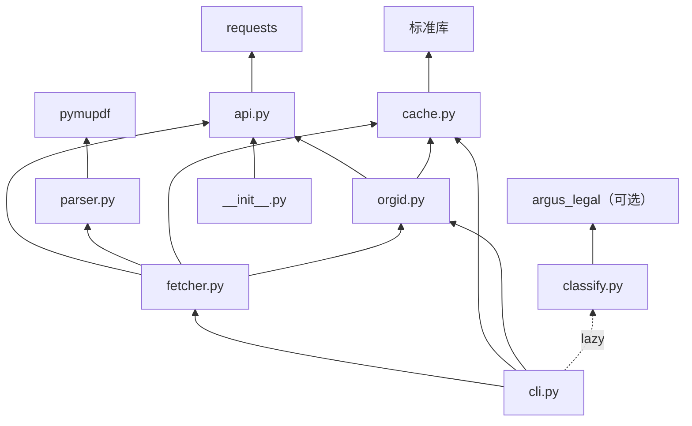

# 模块职责与依赖关系

本页按模块说明“它负责什么、暴露什么、依赖谁、不该做什么”。函数级细节见 [core-api.md](core-api.md)、[cache-and-orgid.md](cache-and-orgid.md)、[fetcher.md](fetcher.md)、[cli.md](cli.md)。

## 1. 模块总览

| 模块 | 源文件 | 一句话职责 | 关键符号 |
|---|---|---|---|
| `api` | [api.py](../src/cninfo/api.py) | cninfo HTTP 客户端 + 公告字段清洗 | `query_page`、`query_all`、`clean_title`、`epoch_ms_to_ann_date`、`is_kind_report_body` |
| `parser` | [parser.py](../src/cninfo/parser.py) | PDF → 全文文本与页数统计 | `ParsedPdf`、`parse_pdf_bytes`、`parse_pdf_file` |
| `cache` | [cache.py](../src/cninfo/cache.py) | 三件套持久化、orgid_map、统计/校验/清理 | `CachePaths`、`paths_for`、`write_*`、`verify`、`prune_older_than` |
| `orgid` | [orgid.py](../src/cninfo/orgid.py) | secCode → orgId 解析与缓存 | `lookup_orgid`、`get_orgid`、`stock_param`、`OrgIdNotFound` |
| `classify` | [classify.py](../src/cninfo/classify.py) | 外部公告分类器的可选薄包装 | `classify`、`is_available`、`ClassifierUnavailable` |
| `fetcher` | [fetcher.py](../src/cninfo/fetcher.py) | 编排查询、抓取、缓存、解析 | `FetchResult`、`fetch_announcement`、`iter_stock_announcements`、`find_periodic_report` |
| `cli` | [cli.py](../src/cninfo/cli.py) | argparse 子命令与输出格式化 | `build_parser`、`main`、`cmd_*` |
| 包入口 | [__init__.py](../src/cninfo/__init__.py) | 版本号 + api 公共符号再导出 | `__version__`、`query_all` 等 |

## 2. 各模块详解

### 2.1 `api.py` — 接口适配层

**职责**

- 固定 cninfo `hisAnnouncement/query` 的请求形态（form-urlencoded、`pageSize=30`、AJAX headers）。
- 单页查询与翻页迭代，屏蔽 `pageSize` 硬限。
- 字段规范化：去除 `<em>` 高亮、UTC epoch ms → 北京日期、6 位代码 → `ts_code`、相对 `adjunctUrl` → PDF 直链。
- 定期报告本体判定（排除摘要、审计、内控等）。
- PDF 二进制下载。

**关键常量**

- `CNINFO_QUERY` / `PDF_BASE` / `DEFAULT_HEADERS`
- `CATEGORY_NDBG` / `CATEGORY_YJDBG` / `CATEGORY_BNDBG` / `CATEGORY_SJDBG`
- `KIND_TO_CATEGORY`（`annual/q1/h1/q3` → category）
- `KIND_TO_TITLE_TAIL`（用于标题尾部匹配）
- `PLATE_TO_SUFFIX`（`sz/sh/bj` → `SZ/SH/BJ`）
- `BEIJING`（UTC+8 时区）

**依赖**：`requests`、`re`、`time`、`datetime`。

**边界**：纯函数 + 轻量 I/O，不读写本地缓存，不感知 CLI。

### 2.2 `parser.py` — PDF 解析层

**职责**

- 用 PyMuPDF（`fitz`）逐页提取文本，统计总页数与有文本的页数。
- 用 `ParsedPdf.is_scanned` 标识“有页但无文本”的扫描件。

**关键符号**

- `ParsedPdf`：`text`、`total_pages`、`extracted_pages`、`text_chars`、`is_scanned`
- `parse_pdf_bytes(data)` / `parse_pdf_file(path)`

**依赖**：`pymupdf`。

**边界**：不做 OCR；不决定是否缓存；不理解公告语义。

### 2.3 `cache.py` — 本地持久化层

**职责**

- 定义缓存根目录（`CNINFO_CACHE_DIR` 可覆盖）。
- 定义三件套路径规则与命中判断（`CachePaths.all_exist`）。
- 读写 PDF、Markdown（含 YAML frontmatter）、meta JSON。
- 维护 `orgid_map.json`。
- 缓存统计（`stats`）、一致性校验（`verify`）、按时间清理（`prune_older_than`）。

**关键符号**

- `cache_root()`、`CachePaths`、`paths_for()`
- `write_pdf` / `write_md` / `write_meta` / `read_meta` / `read_md`
- `load_orgid_map` / `save_orgid_map` / `upsert_orgid`
- `CacheStats` / `stats` / `verify` / `prune_older_than`

**依赖**：仅标准库（`json`、`os`、`shutil`、`pathlib`、`dataclasses`）。

**边界**：不知道 cninfo 字段含义；不发起网络请求；不负责去重。

### 2.4 `orgid.py` — orgId 服务

**职责**

- 从 `~/.cache/cninfo/orgid_map.json` 读取 `secCode → orgId`。
- 缺失时请求 cninfo `topSearch/query`，精确匹配 `code` 后写回缓存。
- 生成 `hisAnnouncement/query` 所需的 `stock` 参数 `<6位>,<orgId>`。

**关键符号**

- `TOPSEARCH_URL`
- `OrgIdNotFound`
- `lookup_orgid(sec_code, timeout=10, session=None)`
- `get_orgid(sec_code, fetch_if_missing=True)`
- `stock_param(sec_code)`

**依赖**：`requests`、`cninfo.api.DEFAULT_HEADERS`、`cninfo.cache`。

**边界**：不负责代码合法性校验（不验证是否 6 位）；不做退市判断；仅在“缓存缺失且允许回源”时联网。

### 2.5 `classify.py` — 分类器薄包装

**职责**

- 动态导入外部 `argus_legal.AnnouncementClassifier`，进程内用 `lru_cache(maxsize=1)` 复用实例。
- 对标题（可选日期）打标签，返回 `type` / `sub_type` / `legal_ref` 等字段。
- 未安装时抛出带安装指引的 `ClassifierUnavailable`；`is_available()` 提供不抛异常的探测。

**关键符号**

- `_get_classifier()`（私有，带缓存）
- `classify(title, ann_date=None)`
- `is_available()`
- `ClassifierUnavailable`

**依赖**：外部可选包 `argus_legal`（来自 `rollysys/announcement_filter`）。

**边界**：不把该依赖写入 `pyproject.toml`；不内置规则；不缓存分类结果。

### 2.6 `fetcher.py` — 用例协调层

**职责**

- `fetch_announcement`：单条公告的“归一化 → 缓存判断 → 下载 → 解析 → 落盘 → 返回结果”。
- `iter_stock_announcements`：按股票 + 时间窗查询（自动 orgId、自动 column）。
- `iter_market_slice`：按板块 + 日期/区间查询全市场切片。
- `find_periodic_report`：在默认披露窗口内定位指定年份、指定类型的报告本体。

**关键符号**

- `FetchResult`（dataclass，`to_dict()`）
- `_norm_item`（私有归一化）
- `fetch_announcement(item, plate, force=False, session=None)`
- `iter_stock_announcements(...)` / `iter_market_slice(...)` / `find_periodic_report(...)`

**依赖**：`api`、`parser`、`cache`、`orgid`、`requests`。

**边界**：不解析命令行；不处理输出格式；不做批量并发；去重与失败重试未实现。

### 2.7 `cli.py` — 命令行接口

**职责**

- 用 argparse 定义 6 个子命令及其参数。
- 调用 `fetcher` / `cache` / `orgid` 完成动作。
- 统一输出：默认表格，`--json` 输出 JSON；错误写 stderr。
- 返回进程退出码。

**关键符号**

- `build_parser()` / `main(argv=None)`
- `cmd_fetch_report` / `cmd_fetch_stock` / `cmd_list` / `cmd_search` / `cmd_cache` / `cmd_orgid`
- 辅助：`_print_json`、`_print_table`、`_err`、`_human_bytes`、`_parse_older_than`

**依赖**：`api`、`cache`、`fetcher`、`orgid`，以及懒加载的 `classify`。

**边界**：不做业务计算；不直接发 HTTP（通过 fetcher/orgid）；不管理缓存文件（通过 cache）。

## 3. 依赖关系图

## 4. 模块边界原则

| 原则 | 含义 |
|---|---|
| 下层不 import 上层 | `api` 不知道 `fetcher`，`cache` 不知道 `cli` |
| 网络集中 | 只有 `api.py` 与 `orgid.py` 直接构造 HTTP 请求 |
| 文件系统集中 | 只有 `cache.py` 直接读写缓存目录 |
| 可选依赖隔离 | 只有 `classify.py` 触碰 `argus_legal`，且动态导入 |
| CLI 只做编排 | 业务逻辑不写进 `cli.py`，便于 Python API 复用 |
